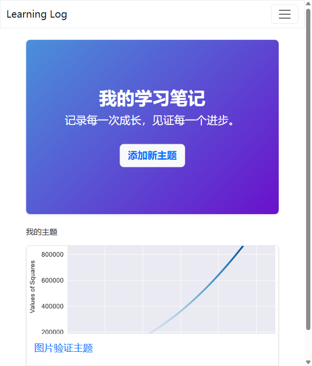
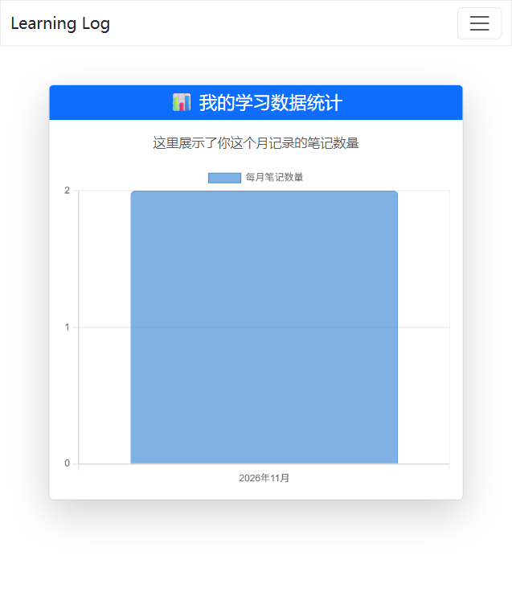
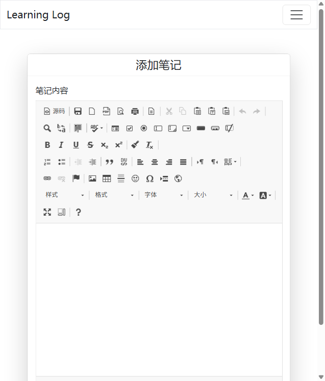
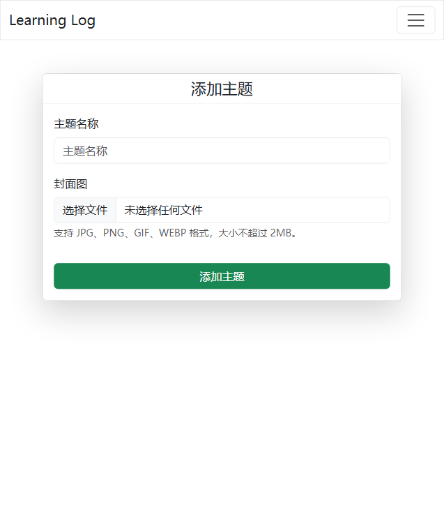
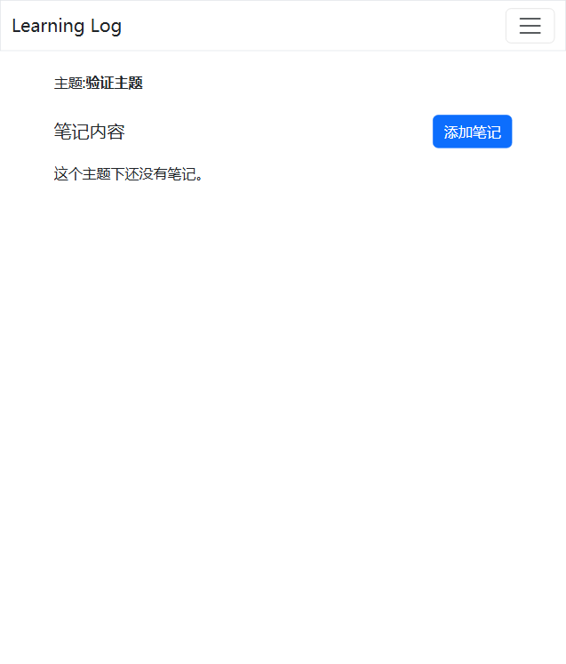

# Learning Log（学习笔记）

一个基于 **Django 6** 开发的多用户学习笔记系统：每个用户拥有自己的主题（Topic）和笔记（Entry），支持富文本、封面图、关键词搜索、数据统计仪表盘和回收站恢复。

项目名称 `Learning Log`，Django 项目包名 `mysite`，主应用 `learning_logs`，用户认证应用 `accounts`。

## 功能清单

| 模块 | 说明 |
|---|---|
| 用户认证 | 注册、登录、登出（Django 内置 `LoginView` / `LogoutView` + 自定义注册表单 `accounts/forms.py`） |
| 多用户隔离 | `Topic.owner` 外键关联 `User`，每个用户只能看到、编辑自己的主题与笔记 |
| 主题管理 | 新建、编辑、删除主题；可为主题上传封面图（`topic_covers/`） |
| 笔记管理 | 在指定主题下新建、编辑、删除笔记，支持富文本（django-ckeditor） |
| 关键词搜索 | 前端实时搜索建议接口 `api/search/`，输入主题或笔记关键词即时提示 |
| 数据仪表盘 | `dashboard/` 按月份统计笔记数量，前端用 Chart.js 绘制柱状图，数据来自 `api/chart_data/` |
| 回收站 | `Topic` 与 `Entry` 均有 `is_deleted` 软删除字段，删除后进入回收站，可单条恢复或一键清空 |
| 个人资料页 | `profile/` 展示当前用户信息与其主题统计 |
| 响应式界面 | Bootstrap 5 + 自定义 `style.css` + animate.css 入场动画，适配手机屏幕 |

## 界面预览

首页 + 带封面图的主题：



学习数据仪表盘：



新建/编辑笔记表单（含 CKEditor 富文本工具栏）：



表单帮助文本说明：



主题详情页：



## 技术栈

- Python 3.12+（开发环境使用 Python 3.14 / Django 6.1.2）
- Django 6.1.2
- django-bootstrap5 26.4（前端组件）
- django-ckeditor 6.7.4（富文本编辑器）
- Pillow 13.0.0（图片上传处理）
- Chart.js（仪表盘图表，CDN 引入）
- SQLite（开发数据库，`db.sqlite3`）

## 目录结构

```
learning_log/
├── manage.py
├── requirements.txt
├── db.sqlite3              # 本地开发数据库（未纳入版本控制）
├── media/                  # 用户上传的图片（未纳入版本控制）
├── mysite/                 # 项目配置
│   ├── settings.py         # 应用注册、数据库、静态/媒体路径
│   ├── urls.py             # 根路由，挂载 admin / accounts / learning_logs
│   └── wsgi.py, asgi.py
├── accounts/               # 用户认证应用
│   ├── forms.py            # 注册表单
│   ├── views.py            # 注册视图
│   ├── urls.py             # login / logout / register
│   └── templates/accounts/ # login.html, register.html
└── learning_logs/          # 核心应用
    ├── models.py           # Topic、Entry
    ├── views.py            # 主题/笔记 CRUD、搜索、仪表盘、回收站
    ├── urls.py             # 全部业务路由
    ├── migrations/         # 0001~0006
    ├── static/learning_logs/css/   # style.css, animate.min.css
    └── templates/learning_logs/    # 13 个页面模板
```

## 快速开始

```bash
# 1. 克隆仓库
git clone git@github.com:liangwenfei-dev/learning_log.git
cd learning_log

# 2. 创建并激活虚拟环境（Windows）
python -m venv venv
venv\Scripts\activate

# 3. 安装依赖
pip install -r requirements.txt

# 4. 初始化数据库
python manage.py migrate

# 5. 创建管理员账号（可选）
python manage.py createsuperuser

# 6. 启动开发服务器
python manage.py runserver
```

浏览器打开 http://127.0.0.1:8000/ 即可使用；后台管理在 http://127.0.0.1:8000/admin/。

## 主要路由

| 路径 | 视图 | 说明 |
|---|---|---|
| `/` | `IndexView` | 首页，列出当前用户的主题 |
| `/topics/<pk>/` | `TopicDetailView` | 主题详情，展示其下笔记 |
| `/new_topic/` | `NewTopicView` | 新建主题 |
| `/edit_topic/<pk>/` | `EditTopicView` | 编辑主题 |
| `/delete_topic/<pk>/` | `DeleteTopicView` | 删除主题（软删除） |
| `/new_entry/<topic_id>/` | `NewEntryView` | 新建笔记 |
| `/edit_entry/<pk>/` | `EditEntryView` | 编辑笔记 |
| `/delete_entry/<pk>/` | `DeleteEntryView` | 删除笔记（软删除） |
| `/trash/` | `TrashListView` | 回收站 |
| `/restore_topic/<topic_id>/` | `restore_topic` | 恢复主题 |
| `/empty_trash/` | `empty_trash` | 清空回收站 |
| `/dashboard/` | `dashboard` | 数据统计看板 |
| `/api/chart_data/` | `chart_data` | 图表 JSON 数据 |
| `/api/search/` | `search_suggestions` | 搜索联想接口 |
| `/profile/` | `profile` | 个人资料 |
| `/accounts/login/`、`logout/`、`register/` | accounts | 登录、登出、注册 |

## 说明

- `venv/`、`media/`、`topic_covers/`、`db.sqlite3`、`__pycache__/` 已写入 `.gitignore`，不纳入版本控制。克隆后需要自己 `migrate` 建库、上传图片会重新生成。
- `mysite/settings.py` 目前使用开发配置：`DEBUG = True`、`SECRET_KEY` 明文写死、`ALLOWED_HOSTS = []`。**部署到生产环境前必须改为环境变量读取、关闭 DEBUG、填入域名**。
- 项目仅供学习练习使用。
